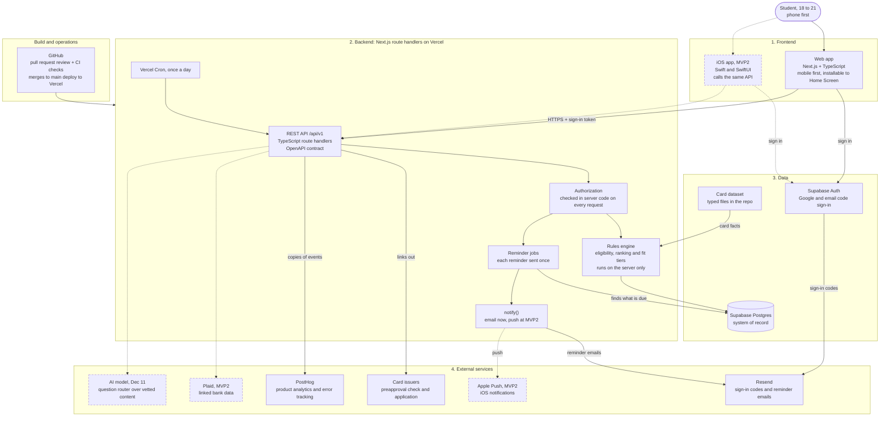

# CENSE

CENSE helps students choose a first credit card with clear, personalized guidance and build healthy credit habits afterward.

## Repository layout

- `web/` — Next.js 16, TypeScript, Tailwind CSS, shadcn/ui, Zod, and Supabase
- `ios/` — native SwiftUI app shell
- `api/openapi.yaml` — shared REST contract for web and iOS clients
- `tokens.json` — shared design tokens for both platforms

## Architecture

### Stack

| Layer | Choice |
| --- | --- |
| Frontend | Next.js 16 and TypeScript, styled with Tailwind CSS. Mobile-first web app that can be installed to the Home Screen. A native SwiftUI app follows in MVP2 and calls the same API. |
| Backend | TypeScript on Node.js. Next.js route handlers under `/api/v1`, described by `api/openapi.yaml`. Business rules run on the server only. The reminder job runs once a day on Vercel Cron (see Reminder emails below). |
| Database | Supabase Postgres. Schema changes only through SQL migrations in this repo. Row level security on every table that holds user data. |
| Auth | Supabase Auth with Google and a 6-digit email code, plus optional password sign-in. Sign in with Apple is added later. |
| Hosting | Vercel. Every pull request gets a preview deployment; `main` is production. |
| Email | Resend, for sign-in codes and reminders. |
| Analytics and errors | PostHog, with pseudonymous IDs. |
| Testing and CI | Vitest for unit and integration tests, Playwright for end-to-end journey tests run locally, GitHub Actions on every pull request. |

### Diagram

Solid boxes ship in MVP1 (Oct 26). Dashed boxes come in MVP2 (Nov 9) or by Demo Day (Dec 11).



### External services

| Service | What we use it for | When |
| --- | --- | --- |
| Supabase | Postgres database and sign-in | MVP1 |
| Vercel | Hosting, preview deployments, scheduled jobs | MVP1 |
| Resend | Sign-in codes and reminder emails | MVP1 |
| PostHog | Product analytics and error tracking | MVP1 |
| Google OAuth | "Sign in with Google" through Supabase Auth | MVP1 |
| Card issuer websites | Links out to each issuer's own preapproval check and application. No API; Cense never submits an application. | MVP1 |
| GitHub Actions | CI checks on every pull request | MVP1 |
| Plaid | Linked bank data | MVP2 |
| Apple Push Notification service | iOS notifications | MVP2 |
| An AI model (provider not chosen) | Routing questions to vetted content. It never makes the recommendation. | By Dec 11 |

### Environments

| Environment | Where it runs | Database |
| --- | --- | --- |
| Local | Your laptop, `npm run dev` | Supabase dev project |
| Preview | Vercel, one per pull request | Supabase dev project |
| Production | Vercel, from `main` | Supabase production project (created before the first real student uses the app) |

### Technical risks and mitigations

| Risk | Mitigation |
| --- | --- |
| Google sign-in may not work inside the app once it is saved to the iPhone Home Screen. An installed web app keeps its own storage, separate from Safari, and redirect-based sign-in has reported failures there. | The 6-digit email code works in that setting and is always offered. Google sign-in is tested on a real iPhone, in Safari and from the Home Screen, before MVP1. |
| A signed-in user can reach Supabase's data API directly, without going through our server. | Row level security and explicit grants on every table that holds user data, plus an automated test in CI that signs in as one user and proves they cannot read another user's records. |
| Card terms and links go stale, so a recommendation could rest on old facts. | Card data lives in typed files in this repo, each card with a last-verified date. It is validated in CI and changes only through a reviewed pull request. |
| The reminder job could send a reminder twice, or stop without anyone noticing. | Each reminder is claimed once by a unique key, so a rerun cannot send it again. A heartbeat check alerts the team if the job stops running. |

### Mentor feedback on the stack

Comments from our mentors on Oct 5, 2026, and what we did with each.

| Mentor | Comment | What we did |
| --- | --- | --- |
| Steven (Slack) | The diagram showed no backend | Redrew it to show the route handlers, rules and reminder jobs. |
| Steven (Slack) | Had you considered Flutter | Staying with Next.js and eventually SwiftUI for higher quality UX at the cost of managing multiple languages and temporarily excluding Android. |
| Steven (meeting) | Wants more backend detail: monolith or microservices, tiers | Diagram to be refined. Workshop meeting with mentors to be scheduled to improve specificity. |
| Kumar (meeting) | Vercel plus Supabase is right for an MVP; moving to AWS later is common | No change. |

## Local setup

```bash
cd web
cp .env.example .env.local
npm install
npm run dev
```

The starter intentionally runs without credentials. Add the Supabase values when the development project is available.

Setup verified from a fresh clone by a second teammate: verified by Yunho on 2026-10-04 (macOS, Node v25.1.0).

### Run the app and journey tests locally

The journey tests (Playwright) and the seed script run against a local Supabase stack, never a hosted project. They need Docker.

This repo has the migrations but no Supabase CLI config yet, so set the stack up once in a separate folder: run `npx supabase init` there, copy `supabase/migrations` into it, and in its `supabase/config.toml` set `site_url = "http://localhost:3300"` and point the `magic_link` and `confirmation` email templates at an HTML file that shows `{{ .Token }}` (the tests read the 6-digit code from the email). Then:

```bash
npx supabase start        # in that folder; Mailpit catches the emails at http://127.0.0.1:54324
npx supabase status       # copy the API URL and publishable key into web/.env.local
cd <this repo>/web
npm run dev:local         # the app on http://localhost:3300
npm run seed:local        # optional: six test students, one per Home state
npm run e2e               # in a second terminal, with the app still running
```

`.env.local` needs `NEXT_PUBLIC_SUPABASE_URL` (the API URL, `http://127.0.0.1:54321`) and `NEXT_PUBLIC_SUPABASE_PUBLISHABLE_KEY`. The optional variables the tests and seed script read are listed in `.env.example`.

Product analytics (PostHog) is off unless `NEXT_PUBLIC_POSTHOG_PROJECT_TOKEN` is set, so local runs, tests and CI send nothing. With it set, the browser sends events to `/rx` on the app's own origin, which `web/next.config.ts` forwards to PostHog (US region); `web/src/proxy.ts` passes on only an allowlist of headers, so session cookies never leave. Every event is defined in `web/src/lib/analytics-catalog.ts` and sent with `track()` from `web/src/lib/analytics.ts`, which rejects anything not in the catalog; the readable tracking plan is [docs/analytics-events.md](docs/analytics-events.md), generated with `npm run analytics:docs`. Addresses lose everything after "?" before sending, and text that restates a student's answers or card status carries the `ph-sensitive` class, which masks it in session replay and keeps it out of autocapture. Team accounts listed in `INTERNAL_STUDENT_IDS` are marked `is_internal`.

## Reminder emails

Vercel Cron calls `GET /api/v1/cron/reminders` once a day at 13:00 UTC (`web/vercel.json`; the Hobby plan runs it at some point in that hour, so 8:00 to 10:00 Eastern). The job schedules every card's next reminders, claims the ones due today, at most one per student, sends each through Resend's API and marks it sent. A student sees a reminder in the app only once its email has gone. Every email has an unsubscribe link and the one-click `List-Unsubscribe` headers. Rules and functions: [api/data-contract.md](api/data-contract.md).

Before it can run:

- Yunho applies `supabase/migrations/20261024220000_reminder_sender.sql` by hand in the Supabase SQL editor, after the reminders migration.
- Mabelle adds these on Vercel (Project Settings, Environment Variables, Production), then redeploys:

| Variable | Where it comes from |
| --- | --- |
| `SUPABASE_SERVICE_ROLE_KEY` | Supabase dashboard, Project Settings, API keys, service_role. Ben or Yunho pastes it in; never in Slack. |
| `CRON_SECRET` | Any long random string (`openssl rand -hex 32`). Vercel sends it with each cron call. |
| `RESEND_API_KEY` | Resend dashboard (Ben), API Keys, sending access for `send.censefinance.com`. |
| `REMINDER_FROM_EMAIL` | `Cense <reminders@send.censefinance.com>` |
| `REMINDER_UNSUBSCRIBE_SECRET` | Any long random string. Changing it breaks the unsubscribe links already sent. |
| `APP_BASE_URL` | The app's public address, for the links in the emails. |

To run it by hand: `curl -H "Authorization: Bearer $CRON_SECRET" https://<app>/api/v1/cron/reminders`. It answers with counts only.

## Quality checks

```bash
cd web
npm run check
```

CI runs linting, type checking, tests, a production build, secret scanning, OpenAPI validation, and an iOS simulator build on every pull request and push to `main`.

## Installed packages

| Area | Package | Purpose |
| --- | --- | --- |
| Framework | `next`, `react`, `react-dom` | Web application and server route handlers |
| Styling | `tailwindcss`, `shadcn`, `@base-ui/react`, `class-variance-authority`, `clsx`, `tailwind-merge`, `tw-animate-css`, `@gravity-ui/icons` | Accessible UI components, icons, and styling |
| Data | `@supabase/supabase-js`, `@supabase/ssr` | Authentication and database client, and the session cookies |
| Analytics | `posthog-js` | Product analytics and session replay through `track()`, off unless its token is set |
| Validation/API | `zod`, `@asteasolutions/zod-to-openapi`, `openapi-typescript` | Runtime schemas and generated API contracts |
| Quality | `eslint`, `typescript`, `vitest`, `@playwright/test`, `@axe-core/playwright` | Linting, type checking, tests, and journey tests with accessibility checks |

See `web/package.json` and `web/package-lock.json` for exact versions.

Icons come from `@gravity-ui/icons`. `web/components.json` still says `"iconLibrary": "lucide"` because shadcn only accepts the libraries it supports and falls back to lucide when the field is missing. A component added with `npx shadcn add` may import `lucide-react` and add it to `package.json`: swap its icons for Gravity UI ones and remove the package.

## Accounts and keys

Who holds each account. Key values are never stored in this repo or sent over Slack. They live in Vercel's environment variables and in the Supabase dashboard; `web/.env.example` lists the variable names.

| Account | Held by | Status (Oct 4) |
| --- | --- | --- |
| GitHub repository | Mabelle (owner) | Active |
| Vercel | Mabelle | Connected to this repo on Oct 4; `main` deploys to production |
| Supabase, dev project | Ben (organization owner); Mabelle and Yunho as admins | Created |
| Supabase, production project | Ben | Not created yet; needed before real students use the app |
| Resend | Ben | Being set up |
| PostHog | Not assigned yet | Not created yet |
| Google OAuth client | Yunho, with the sign-in work | Not created yet |
| Domain | Ben | Not purchased yet |

## How we work

- Branching, pull requests, review and merging: see [CONTRIBUTING.md](CONTRIBUTING.md).
- Project board: the [CENSE backlog in Notion](https://app.notion.com/p/CENSE-e65780cd945383649fc6813e1593290a) holds the user stories, sub-tasks, sprints and status.
- AI Usage Log: [docs/ai-usage-log.md](docs/ai-usage-log.md).
