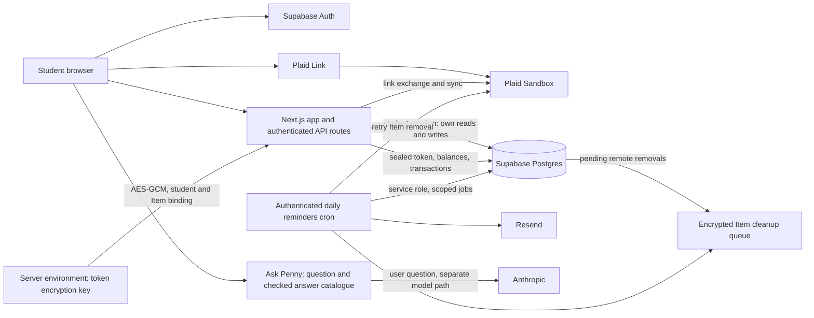

# Cense architecture for mentor review

Updated November 27, 2026. Baseline: main `82098ab`. This describes the implemented server/bank-data boundaries, with pending work identified separately. The [Your money planning ERD](your-money-erd.md) includes proposed entities; those are not all deployed tables.

## What is implemented

- The browser signs in through Supabase Auth. Application routes require the signed-in student; database ownership rules and scoped functions provide isolation. The service role is reserved for explicit privileged jobs, not the normal student-facing bank read path.
- Plaid is sandbox-only on main. The browser's Plaid Link flow hands the public token to the server for exchange. The server seals the long-lived access token with AES-256-GCM and binds it to its student and Item. The encryption key stays outside the database.
- Stored balances support the daily safe-to-spend figure. Stored transactions include amount, posted date, account reference, categories, merchant, description and detected payment-app information. Do not put transaction examples or real user data in the diagram.
- Disconnect/account deletion clears the relevant local bank data and can queue encrypted tokens when remote removal is not confirmed. The authenticated daily cron retries remote cleanup. Losing the encryption key is not a safe deletion mechanism; queued as well as active tokens require a recovery plan.
- The recurring detector in merged #109 is a pure server-side suggestion function. It supports weekly, biweekly, semimonthly and monthly patterns, with handling for family transfers, unnamed income and own-account transfers. It does not itself persist stream corrections or schedule monthly runs.
- Ask Penny is a separate question/checked-answer path. No automatic bank-transaction input is added to the model by this diagram; user-entered free text still needs its existing data handling controls.

## Pending changes and rollout order

| Work | State on November 26 | Dependency / boundary |
| --- | --- | --- |
| Keep transactions while a bank stays linked | #135 open, unchanged | Yunho removes age purge and sync cutoff; migration and deployment require verification. |
| Request up to 730 days on a new bank link | #134 draft | Wait for #135 and revised consent; does not extend existing Items. |
| Persist counterparty name, city and state | #136 draft | Wait for #135, adapt API, retarget main and revalidate. |
| Read stored transactions into setup findings | #137 now ready for review | Shared route, first-link inference and confirmation UI. Review found a concurrent-answer overwrite and a #143 spread-spending integration conflict. |
| Rolling dated-bill calculation | #143 in review | Correctly counts actual due dates; continuous groceries/gas must not use the same day-31 sentinel when combined with #137. |
| Calendar and five-tab navigation | #141 and #142 in review | #142 remains stacked on feat/calendar-c1. No base branches deleted. |
| Bank update notices and real-bank redirect | Assigned for November 30 | Pending implementation and independent pilot checks; no live-bank readiness claimed. |
| Recurring runs, persistent stream corrections, forecasts/goals | Follow-up / proposed model | Use a durable link-scoped identity; the unnamed detector candidate hash can change with amount bands. Confirm product scope against the roadmap. |

Ben owns the separate consent, row-cap and inactive-account deletion changes. This document does not authorize merges or production deployment.

## Mentor discussion

1. Do the implemented controls and the pending work support a truthful sandbox demo of bank link → findings → corrections → goal/plan → next action? Goal/plan screens must be identified as pending until shipped.
2. For recurring corrections, should a student correct an individual inferred occurrence, the ongoing stream, or both? Preserve that distinction in the ERD.
3. What evidence is needed before attempting a real-bank rehearsal? Keep sandbox demo readiness separate from pilot sign-off.

## Verification and sharing

The November 26 code reviews ran 42 focused tests on #137, 111 on #143, 45 on #141 and 13 on #142; all baseline suites passed. Additional synthetic review cases reproduce the concurrent-answer overwrite and two spread-reserve date failures. These results do not establish hosted database migrations, mobile visual fidelity or real-bank readiness.

The engineering security-program review is tracked separately. This draft accompanies the ERD for team review; it does not certify security or pilot readiness. It has not been posted to mentors in Slack or edited into Figma.
