# Cense Your Money ERD

Updated November 27, 2026. This is a planning ERD for Your money, not a map of the deployed database. It combines the bank-link and transaction model on main (`82098ab`) with explicitly proposed detection, correction and forecasting entities. #94 and #109 are merged. Counterparty/location columns and their sync integration remain pending in #135/#136. Detection runs, persistent recurring corrections and forecast entities below are proposals, not shipped tables.

The November 23 demo direction is link bank → read findings → confirm/fix → choose a goal → accept/edit a plan → show one next action on Home. Goal and plan persistence in the pending [#147](https://github.com/ithlambelle/cense/pull/147), stacked on #137, are outside this diagram; do not treat forecast scenarios as an implemented goals feature. Ben owns the pending shared findings route in #137, which is now ready for review. Integrate with that route after review instead of creating a competing detector path.

```mermaid
erDiagram
    AUTH_USER ||--o| PLAID_ITEM : links
    AUTH_USER ||--o| BANK_LINK : owns
    BANK_LINK ||--o{ BANK_BALANCE : has
    PLAID_ITEM ||--o{ BANK_TRANSACTION : imports
    PLAID_ITEM ||--o{ BANK_ACCOUNT : contains
    BANK_ACCOUNT ||--o{ BANK_TRANSACTION : records
    BANK_ACCOUNT ||--o{ BALANCE_SNAPSHOT : captures
    PLAID_ITEM ||--o{ DETECTION_RUN : runs
    PLAID_ITEM ||--o{ RECURRING_STREAM : identifies
    DETECTION_RUN ||--o{ RECURRING_ESTIMATE : produces
    RECURRING_STREAM ||--o{ RECURRING_ESTIMATE : has
    RECURRING_STREAM ||--o| STREAM_CORRECTION : accepts
    AUTH_USER ||--o{ CASH_FLOW_OCCURRENCE : owns
    RECURRING_STREAM o|--o{ CASH_FLOW_OCCURRENCE : schedules
    CASH_FLOW_OCCURRENCE ||--o{ OCCURRENCE_MATCH : reconciles
    BANK_TRANSACTION ||--o{ OCCURRENCE_MATCH : settles
    AUTH_USER ||--o{ FORECAST_SCENARIO : saves
    FORECAST_SCENARIO ||--o{ SCENARIO_ADJUSTMENT : contains
    CASH_FLOW_OCCURRENCE o|--o{ SCENARIO_ADJUSTMENT : targets

    AUTH_USER["auth.users · existing"] {
        uuid id PK
    }
    PLAID_ITEM["plaid.items · existing"] {
        uuid student_id PK,FK
        text item_id UK
    }
    BANK_LINK["public.bank_links · existing"] {
        uuid student_id PK,FK
        timestamp refreshed_at
    }
    BANK_BALANCE["public.bank_balances · existing"] {
        uuid student_id PK,FK
        smallint position PK
        text kind
        bigint balance_cents
    }
    BANK_TRANSACTION["plaid.transactions · main + pending fields"] {
        uuid student_id PK,FK
        text transaction_id PK
        text account_id FK "Proposed account reference"
        date posted_on
        bigint amount_cents
        boolean pending
        text category
        text merchant_name
        text category_detailed
        text description
        text payment_app
        text counterparty_name "Pending 135 and 136"
        text location_city "Pending 135 and 136"
        text location_state "Pending 135 and 136"
    }
    BANK_ACCOUNT["Bank account · proposed"] {
        uuid student_id PK,FK
        text account_id PK
        text display_name
        text kind
        boolean include_in_forecast
    }
    BALANCE_SNAPSHOT["Balance snapshot · proposed"] {
        uuid student_id PK,FK
        text account_id PK,FK
        timestamp observed_at PK
        bigint balance_cents
    }
    DETECTION_RUN["Detection run · proposed"] {
        uuid student_id PK,FK
        uuid run_id PK
        timestamp completed_at
        date window_start
        date as_of_date
    }
    RECURRING_STREAM["Recurring stream · proposed"] {
        uuid student_id PK,FK
        text stream_key PK "Proposed persistent stream identity"
        text kind "bill or income"
    }
    RECURRING_ESTIMATE["Recurring estimate · proposed"] {
        uuid student_id PK,FK
        uuid run_id PK,FK
        text stream_key PK,FK
        text display_name
        text cadence
        jsonb payday_days "Proposed for semimonthly pay"
        boolean family_support
        bigint amount_cents
        date next_date
        text suggested_category "Nullable"
        integer observation_count
        date first_observed_on
        date last_observed_on
    }
    STREAM_CORRECTION["Student correction · proposed"] {
        uuid student_id PK,FK
        text stream_key PK,FK
        text decision "Unreviewed, confirmed, or dismissed"
        text category_override "Nullable"
        bigint amount_override_cents "Nullable"
        text cadence_override "Nullable, changes future occurrences"
        date schedule_anchor_override "Nullable, changes future occurrences"
        timestamp updated_at
    }
    CASH_FLOW_OCCURRENCE["Cash flow occurrence · proposed"] {
        uuid student_id PK,FK
        uuid occurrence_id PK
        text stream_key FK "Nullable for manual entries"
        date original_date "Stable date for a generated occurrence"
        date date_override "Nullable, applies to this occurrence"
        text display_name
        text kind "bill or income"
        bigint expected_amount_cents
        bigint amount_override_cents "Nullable, applies to this occurrence"
        bigint settled_amount_cents
        text status "Expected, partial, settled, or skipped"
    }
    OCCURRENCE_MATCH["Transaction match · proposed"] {
        uuid student_id PK,FK
        uuid occurrence_id PK,FK
        text transaction_id PK,FK
        bigint applied_amount_cents
    }
    FORECAST_SCENARIO["Forecast scenario · proposed"] {
        uuid student_id PK,FK
        uuid scenario_id PK
        text name
    }
    SCENARIO_ADJUSTMENT["Scenario adjustment · proposed"] {
        uuid student_id PK,FK
        uuid scenario_id PK,FK
        uuid adjustment_id PK
        uuid occurrence_id FK "Nullable for a new hypothetical expense"
        text action "Add, change, or omit"
        text display_name "For a new hypothetical expense"
        date adjusted_date "Nullable"
        bigint adjusted_amount_cents "Nullable"
    }
```

Each estimate references its run and stream through composite foreign keys that include `student_id`. Save a completed run and its estimates in one transaction. A stream keeps its identity if it drops out of a run, so a dismissal still applies if the detector finds that stream again. Read suggestions from the latest completed run and apply the student’s correction on read. Corrections persist across reruns for the same Plaid link. On disconnect, clear bank-derived accounts, snapshots, streams, and generated occurrences. Manual events and saved scenarios belong to the student. Remove any scenario adjustment that targets a deleted occurrence.

A generated occurrence has a stable ID and a unique `(student_id, stream_key, original_date)` slot. A rerun reconciles outstanding slots before creating new ones and preserves occurrence-level edits and settlements. Manual events belong directly to the student. Overdue is derived from the effective date and any outstanding amount. Matches are many-to-many and allocate part of a posted transaction to an occurrence, supporting split payments. Update the settlement and its allocations together and cap the allocated total at the transaction amount. If a future cleanup removes raw matches while a manual event is retained, preserve its settled state so cleanup cannot reopen a paid bill. Bank-derived data must still be deleted on disconnect; keeping a settlement is not an exception to that deletion rule.

| Feature | Data used |
| --- | --- |
| Why did Cense flag this? | Observation count, date range, cadence, and typical amount from the latest estimate. |
| Coming up and before payday | Start from the latest snapshot for each selected cash account. Apply outstanding occurrences in date order through the next expected paycheck and show the lowest projected balance along the way. Show an unknown payday if no income date is available. |
| This month | Count posted transactions in actual totals. Include only the unsettled portions of occurrences in upcoming obligations. |
| What changed this month? | Compare estimates for the same stream across completed runs. A stream missing from the latest run means it went undetected and needs confirmation before labeling it canceled. |
| One-time expense preview | Apply an unsaved adjustment in the current session. Persist a named scenario and its adjustments when the student saves it. |
| Testathon demo | Run the same logic against synthetic balances and transactions. |

For the first implementation, retain the latest completed run and persist corrections, then verify one occurrence through detection, a date edit, and a posted transaction match. Keep older estimate snapshots when the monthly comparison feature is added. Current main still has the legacy 180-day age cutoff. The agreed target is to request up to 730 days of history for new bank links, then keep transactions while the bank stays linked. #135 removes the age-based purge and sync cutoff; #134 stays draft until that change and revised consent wording land. Ben owns the separate row cap, consent and inactive-account deletion changes. Do not present the target policy as already deployed.

The detector key is a candidate matching key, not yet a durable correction identity. In particular, unnamed groups can change key when their amount band changes. Before implementing corrections, define link-scoped persistent stream IDs and reconciliation rules that preserve corrections across reruns without applying a dismissal to a different stream or a newly linked bank. Preserve both calendar payday values for semimonthly income, including month-end schedules. The proposed app reads student-scoped suggestions and summaries through server endpoints.

Source checkpoints: [#109](https://github.com/ithlambelle/cense/pull/109), [#134](https://github.com/ithlambelle/cense/pull/134), [#135](https://github.com/ithlambelle/cense/pull/135), [#136](https://github.com/ithlambelle/cense/pull/136), [#137](https://github.com/ithlambelle/cense/pull/137).
